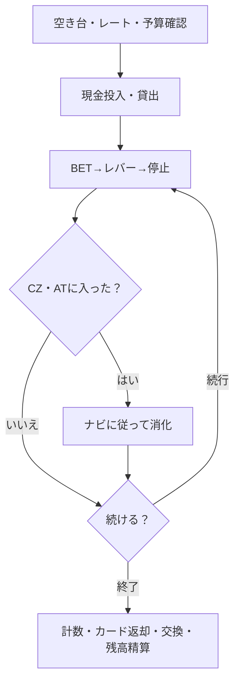
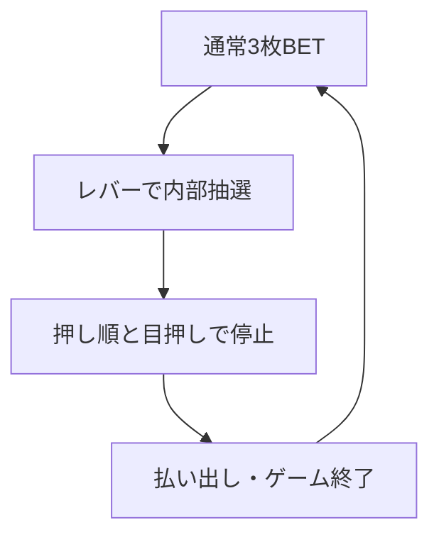
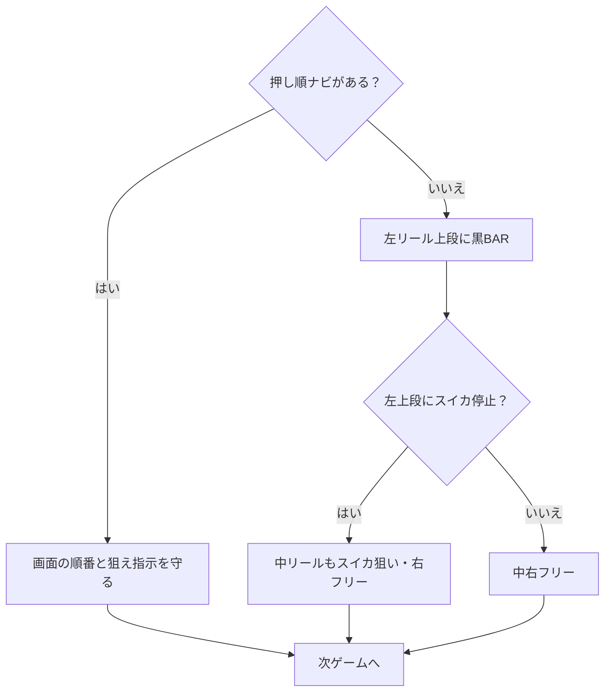
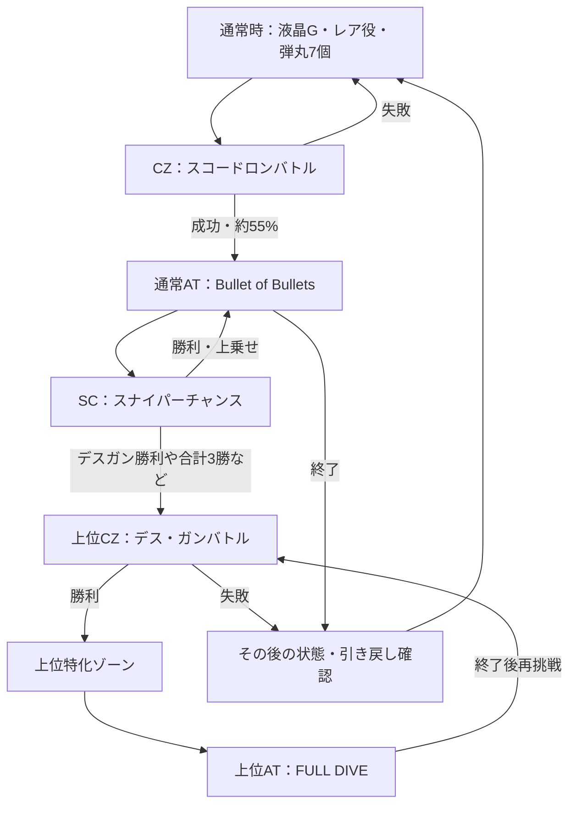
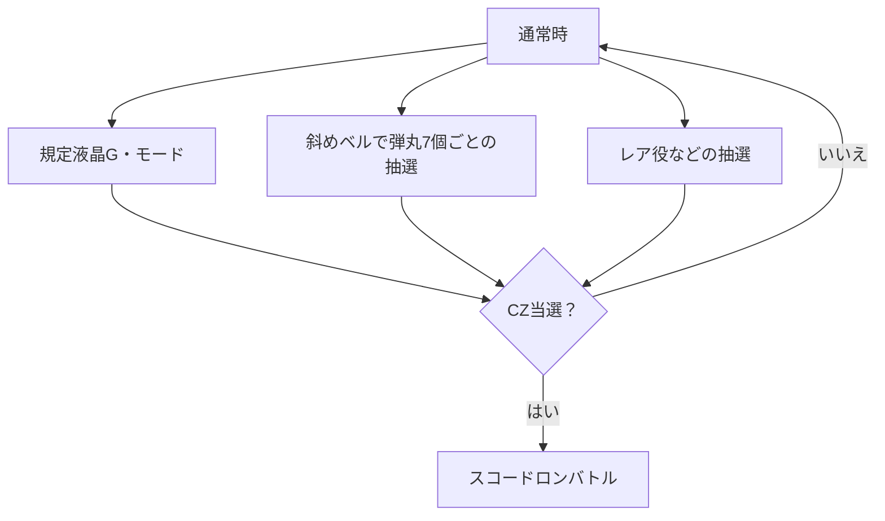
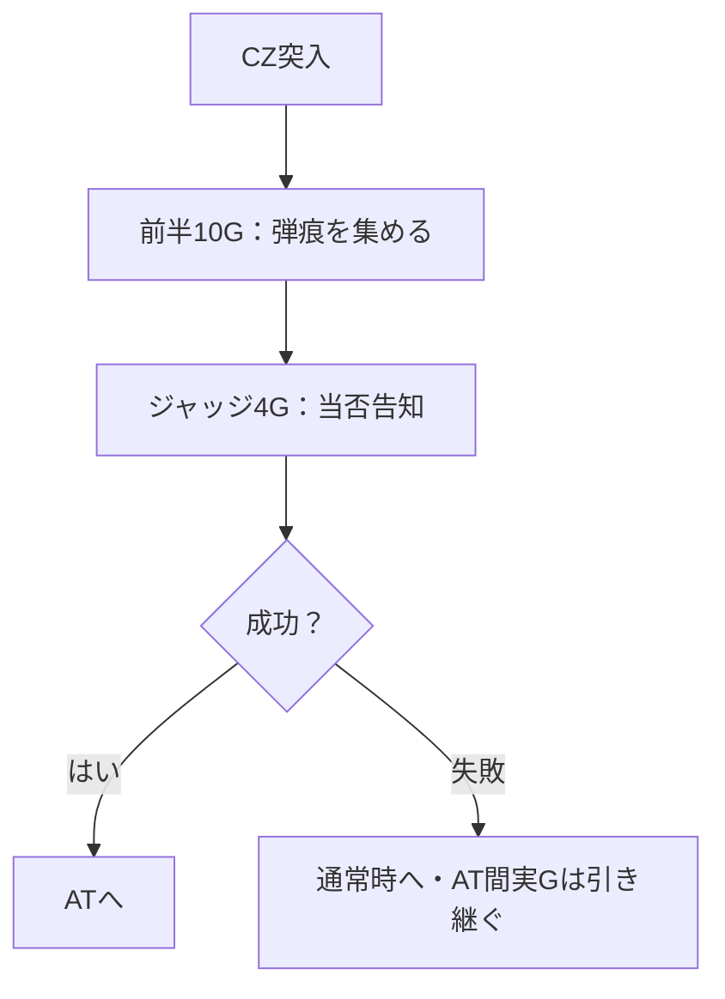
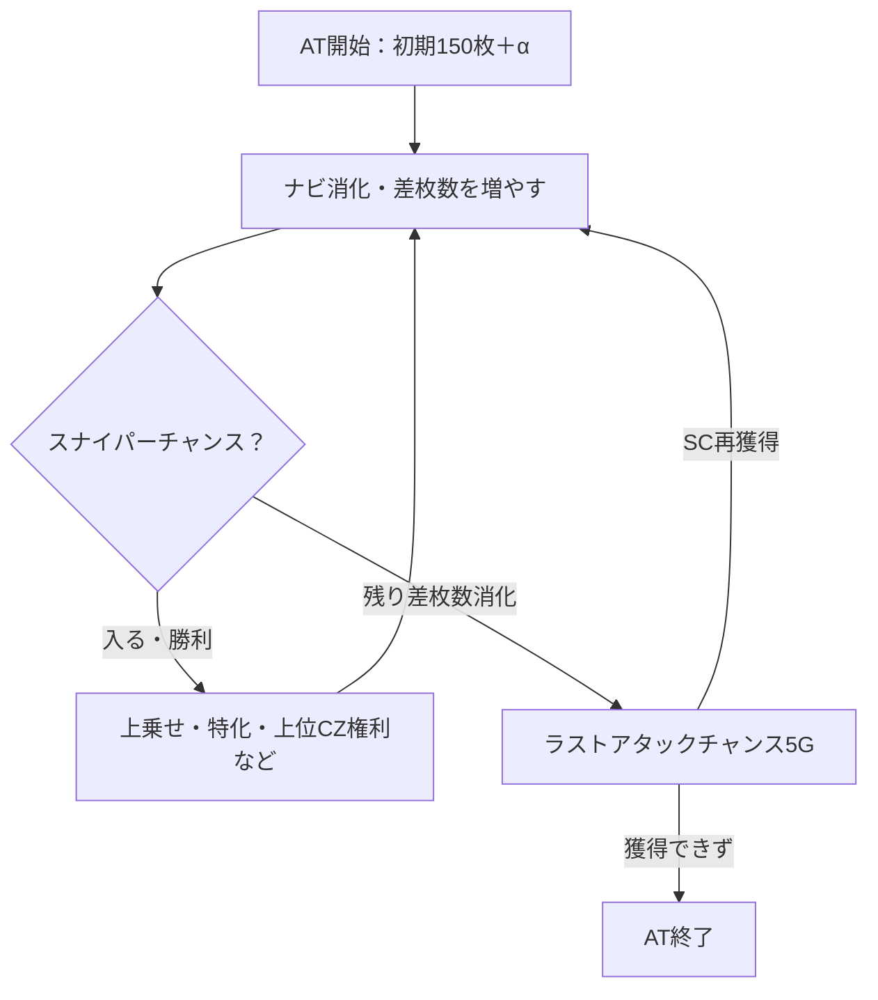
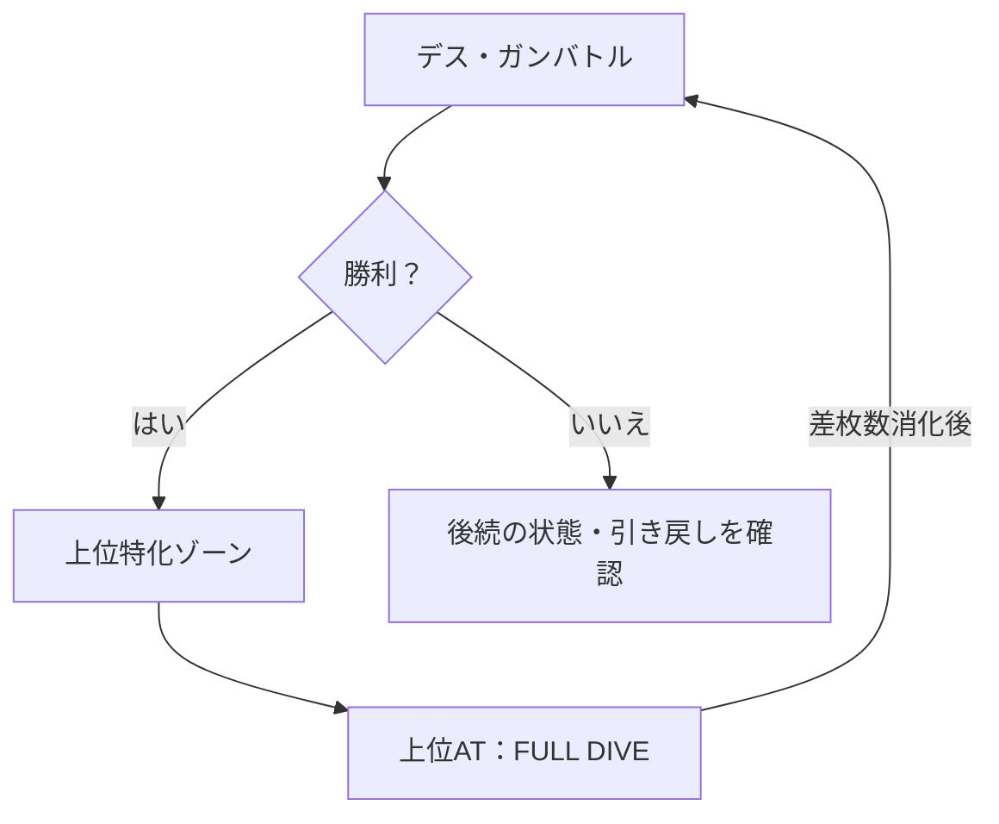
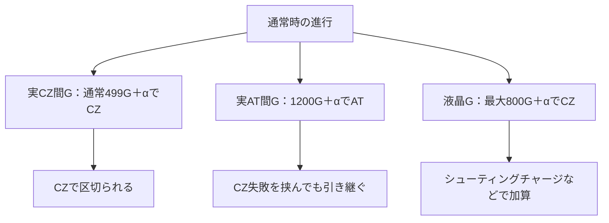
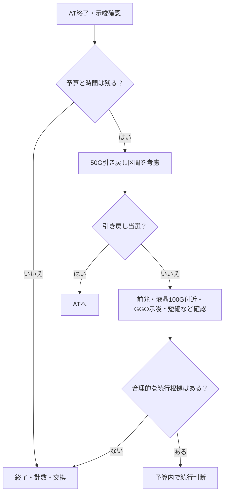

> **引き継ぎ原稿・再照合前**：本文中の調査日・確認済みという記述は以前の作業からの引き継ぎです。2026-10-26のCodex作業ではネットワーク制限で出典本文を再照合できていません。数値や実機条件は検証済みとみなさないでください。現在の教材は[Web版](../index.html)です。

# スロット完全教科書　SAO2特化版

**未経験 → 初打ち → 中級 → 上級を一冊で。**  
対象：2026年6月8日導入『スロット ソードアート・オンラインⅡ』（スマスロ）  
調査基準日：**2026年10月25日**　｜　学習用・実戦用保存版

> この教科書は操作方法と確率・仕組みの理解が目的。利益を保証する攻略法ではない。仕様・演出の一部は解析サイトの調査値・推測値。遊技は18歳以上、予算上限を守り、生活費・借入金は使わない。

## まずこれだけ：初打ち１分チェック

1. **機種の正式名を確認**：「スロット ソードアート・オンラインⅡ」。同名シリーズの旧作とは別物。
2. **現金投入→貸出→MAX BET→レバー→左・中・右の停止ボタン**。画面に押し順が出た場合は、画面の指示が最優先。
3. **通常時は左リールの黒BARを上段付近に狙う**。左上にスイカが停止したら、中リールにもBAR付近のスイカを狙う。右は基本どこで止めてもよい。
4. **通常時に勝手な中押し・逆押しをしない**。ペナルティの恐れがある。
5. **目的は通常時→CZ「スコードロンバトル」→AT「バレットオブバレッツ」**。CZは本当の当たりへのチャレンジ、ATが主な出玉獲得区間。
6. **天井は２種類のカウンター**。実GのCZ間499G+α／AT間1200G+α、液晶GのCZ天井最大800G+α。リセット時は実GのCZ間256G+α。
7. **AT終了後には50Gの引き戻し抽選**。確認後は残りの前兆・モード・持ちアイテム・予算から続行を判断。
8. **やめる時は計数→カード返却→精算・景品交換**。ICカードと現金残高を忘れない。

---

# 第１部　スロットそのものを理解する

## 01｜何をするとメダル（お金）が増減する？

パチスロは、１ゲーム（**1G：１回転**）ごとに内部抽選で成立する役が決まる遊技機。多くの通常ゲームでは**３枚BET**（賭ける枚数３枚）で開始し、ベル・リプレイ・チェリーなどの役に応じて払い出しを受ける。リプレイなら通常は次ゲームを追加のメダル消費なしで遊べる。リールの絵柄を「目押し」しても、抽選で成立していない当たりを自由に作れるわけではない。

**実例：** ３枚BET→ベルの払い出しが８枚なら、そのゲームの差引は＋５枚。３枚BET→ハズレで払い出し０枚なら－３枚（機種や状況によって特殊処理あり）。通常時は小さな減少を繰り返し、ATに入ると増えやすくなる設計。

スマスロは実物のメダルを使用せず、貸出枚数・持ちメダルを電子管理する。画面の「CREDIT」は台にある使用可能枚数、「PAY OUT」は払い出し、「BET」は賭けた枚数。店や機種によって表示位置は違う。

## 02｜絶対に覚える基礎語

| 用語 | 超初心者向けの意味 |
|---|---|
| G（ゲーム） | １回リールを回すこと。300G＝300回転。 |
| BET / MAX BET | 賭ける枚数を設定する操作。通常は３枚で１ゲーム。 |
| リール | 左・中・右の３本の回転する絵柄の列。 |
| 目押し | 狙う図柄が止まるようタイミングを合わせて停止ボタンを押すこと。 |
| 小役 | ベル、スイカ、チェリーなど、成立・入賞すると払い出し等がある役。 |
| レア役 | 出現頻度の低い小役等。CZや上乗せ抽選の契機。 |
| リプレイ | 次ゲームを追加のBET消費なしで遊べる役。 |
| ナビ | 液晶の指示。「１・２・３」ならその順番で停止。 |
| 通常時 | 主にATやCZを目指す、メダルが減りやすい区間。 |
| CZ | チャンスゾーン。成功するとAT等に進める挑戦区間。必ず当たるわけではない。 |
| AT | アシストタイム。押し順ナビなどでメダルを増やす主な当たり区間。 |
| 初当たり | 通常時から最初にCZやATへ入ること。CZ初当たりとAT初当たりは違う。 |
| 純増 | AT中の１Gあたりの平均的な「純粋な増加枚数」。 |
| 上乗せ | ATの残りゲーム数・枚数等が増えること。SAO2は残り獲得枚数が中心。 |
| 特化ゾーン | 上乗せが発生しやすい特別な区間。 |
| 天井 | 一定の条件でCZやATが発生する救済機能。利益の保証ではない。 |
| 前兆 | CZ・AT当選を期待させる演出が続く期間。本前兆とフェイクがある。 |
| ゾーン | 特定のゲーム数付近で当たりやCZを期待できる範囲。 |
| 高確 | 通常よりも特定の抽選が有利な内部状態。 |
| 設定 | 店側が管理する出玉確率の段階。SAO2は１～６。高設定ほど長期の出玉率が高い。 |
| 機械割 / 出玉率 | 非常に長く遊技した場合の払い出し枚数÷投入枚数の理論上の比率。勝率ではない。 |
| 期待値 | 同条件で非常に多く繰り返した場合の平均損益。今回の結果ではない。 |
| 取りこぼし | 入賞可能な役を目押しミス等で揃えられないこと。 |
| フリー打ち | 図柄を狙わず、任意のタイミングでボタンを押すこと。 |
| ペナルティ | 禁止・非推奨の押し方により抽選や進行上の不利益が起こること。 |

## 03｜ホールで座ってから交換まで（スマスロ）

**１：座る。** 台上の荷物・飲み物、離席札、店のルールを確認する。空き台かわからなければ店員に聞く。

**２：専用ユニットに紙幣を入れる。** 多くの店では台の横にある「サンド」「ユニット」で現金を扱う。貸出ボタンで電子メダルを台に移す。1000円で借りられる枚数は店の貸し出しレート次第（例：50枚貸、46枚貸）。

**３：MAX BETを押す→レバーを下げる。** リールが回る。左→中→右の３つの停止ボタンで止める。何もわからなければ「通常時は左を最初に押す」が大原則。

**４：３つ止めて１G終了。** 再度MAX BET→レバー→停止ボタンを繰り返す。リプレイ時には操作が簡略化される場合がある。

**５：当たり中は画面に従う。** 「１・２・３」の指示順に押す。「BARを狙え」「７を狙え」はその図柄を目押し。指示がない時は通常時の小役狙いに戻す。

**６：終了したら計数してカードを返却。** 残りの持ちメダルをユニットに戻す計数ボタン（短押し/長押し）を使用し、ユニットの返却ボタンからICカードを受け取る。店内の交換所・景品カウンターで案内に沿って交換する。残金がある場合は残高精算も忘れない。機械によりボタン配置は違うため、不明なら店員に確認。

> 注意：機械が反応しない、エラーが出た、カードを取り出せないときは、無理に操作せず呼び出しボタンで店員へ。席を離れるときは持ち物・カードを確認。

## 04｜「50枚貸し」「46枚貸し」「等価交換」とは

貸出：いくら払うと何枚借りられるか。**50枚貸なら1000円で50枚／46枚貸なら1000円で46枚**。交換：獲得した電子メダル何枚が景品の価格換算で何円相当か。たとえば**5.6枚交換なら56枚が1000円相当**。実際の精算は店のルール・端数処理に従う。

*例１：50枚貸・50枚交換* → 1000円で50枚借り、50枚を1000円相当で交換する計算上の等価。  
*例２：46枚貸・56枚交換* → 1000円で46枚借りても、獲得56枚で1000円相当。持ちメダルの再使用のほうが現金追加投資より有利になることがある。

投資額＝使った現金などの額。回収額＝獲得した景品等の換算価値。差額＝回収－投資。**グラフが＋1000枚でも、実際の収支＋2万円とは限らない**。

---

# 第２部　SAO2の打ち方をマスターする

## 05｜SAO2の基本データ

| 項目 | 数値・仕様 |
|---|---|
| 仕様 | スマスロ／AT機、2026年6月8日導入、製造元パオン・ディーピー |
| 通常AT | 「Bullet of Bullets」、純増約3.6枚／G |
| 上位AT | 「FULL DIVE」、純増約7.2枚／G |
| 通常ATの初期枚数 | 150枚＋α |
| 通常時ベース | 50枚あたり約31G（平均目安、偏りあり） |
| CZ成功期待度 | 「スコードロンバトル」約55% |
| AT後の引き戻し抽選 | 原則50G |
| CZ間・実G天井 | 499G＋αでCZ |
| AT間・実G天井 | 1200G＋αでAT |
| CZ間・液晶G天井 | 最大800G＋α（内部モードで変化） |
| 設定１の出玉率 | 97.6% |
| 設定６の出玉率 | 114.9% |

**重要：** 50枚で約31Gは「50枚貸しなら必ず1000円で31回転する」という意味ではない。借りるレートや小役の偏りで異なる。荒波仕様なので「AT初当たり約1/386」の設定1でも、386回転までに当たる保証はない。

## 06｜唯一覚えておけばよい通常時の打ち方

- レバーを叩いてリールが回る。
- **左リール枠上～上段に黒いBAR図柄を狙って、左ボタンを押す。** BARとは黒い長方形の『SWORD ART ONLINEⅡ』ロゴのような図柄。
- **左リール上段にスイカが停止した場合**：中リールにもスイカを狙う。中リールの黒BARを目安にすれば狙いやすい。右リールは好きな位置で停止してよい。
- **左リールにスイカが上段停止しなかった場合**：中・右は基本フリー打ちでOK。
- **画面に押し順ナビが出たらナビを優先。** 中押し・右押しの指定がない通常時に自分の判断で逆押ししない。

**目押しのコツ：** 黒BARのある場所を目で追い、１周の周期に慣れる。最初は「左BARだけ」を練習。慌てて連打しない。図柄の正確な位置は巻末のリンク先「リール配列・打ち方」で画像確認。

| 左リールの代表的な停止 | 示唆する成立役 | 残りリールの操作 |
|---|---|---|
| 中段にチェリー | ウルティマ・チェリー（非常に希少） | 中・右はフリー打ちでよい |
| 下段にチェリー | 弱／強チェリー | 中・右はフリー打ちでよい |
| 下段にBAR | ハズレ／ベル／リプレイ／弱チャンス目など | 中・右はフリー打ち |
| 上段にスイカ | スイカ／強チャンス目 | 中はスイカ狙い、右はフリー打ち |

**強弱の見分け：** 弱チェリーは左下段チェリー＋右中段リプレイ、強チェリーは右中段リプレイ以外の停止が代表例。スイカのテンパイ（２リールで揃いそうな形）から３リール目で揃わなければ強チャンス目の例がある。演出・成立役表示がわかるまでは「レア役が来た」程度の理解で十分。

**応用：緑７狙い。** 左リール枠上付近に２連の緑７を狙うとバレット目成立を早く察知できる。面白さはあるが、初打ちには不要。まず黒BAR狙いを安定させる。

## 07｜AT中の操作は？ 特殊ナビに注意

| 画面表示 | 操作 |
|---|---|
| 「１→２→３」などの押し順ナビ | 指定された順番で停止。左右中の順番を勝手に変えない。 |
| 「×・？・？」ナビ | 左を最初に押さず、中または右リールから押す（その時の指示に従う）。 |
| 「BARを狙え」「７を狙え」 | 指定図柄を狙う。できなくてもボタンを適当に連打しない。 |
| ナビなし | 通常時と同じ黒BAR狙いで小役をフォロー。 |

特殊な「狙え」カットインはゲーム進行に関わる場合がある。とくにデス・ガンバトル開始時のBAR狙い指示は従うこと。押し間違えても取り返そうと特殊操作を重ねず、画面指示と店員の案内に従う。

## 08｜ゲームの流れ：通常時から上位ATへ

```text
【通常時】液晶G数／レア役／バレットカウンター
                  ↓
【CZ：スコードロンバトル】約55%で成功
          ├─失敗→通常時（アイテム獲得抽選あり）
          └─成功
                  ↓
【通常AT：バレットオブバレッツ】純増約3.6枚/G
          ↓ スナイパーチャンスで勝利を目指す
          ↓ デス・ガン勝利などで上位CZへ
【上位CZ：デス・ガンバトル】成功期待度約50%
          ├─失敗→引き戻し抽選など
          └─成功→特化ゾーン
                  ↓
【上位AT：FULL DIVE】純増約7.2枚/G
          ↓ 終了後は再び上位CZへ
【上位CZ】にループするチャンス
```

**誤解防止：** 「CZで55%」「上位CZで50%」は平均的な成功期待度。CZ突入時点の状況や小役、特殊状態によって異なる。各段階を成功したからといって最終的な収支がプラスとは限らない。

## 09｜通常時：３つのルートを理解する

**① 液晶ゲーム数・内部モード：** 通常時は画面の「液晶G数」が規定値に達するとCZを抽選。スロットを実際に回した数より液晶G数が進むこともある。内部モードによりチャンスとなる液晶G数が異なる。

**② シューティングチャージ：** レア役などで入る「液晶ゲーム数をまとめて加算する区間」。たとえば実際は５G回しただけでも、液晶のカウンターが100G加算されることがある（例示）。**液晶Gだけ加算され、実Gの天井カウンターを100G進めたわけではない。**

**③ バレットカウンター：** 共通ベル（斜めに揃うベル）のたびに弾丸が１個増え、**７個到達ごとにCZ抽選**。期待度は約20%目安。７個で必ず当選ではなく、失敗しても次の抽選機会がある。カウンターが６個まで来ている台は検討材料になるが、そこで必ず勝てるわけではない。

**GGOモード：** ①の規定ゲーム数モードとは別の有利状態。液晶のアイテム表示などで示唆される。後述。

## 10｜CZ「スコードロンバトル」は何をする？

通常時から進む約55%成功期待度のバトル。**前半10G＋ジャッジ４G**が基本。リール上に見える「バレットサークル（照準の輪）」にバレット図柄が止まる・レア役が成立するなどで**弾痕**を集める。弾痕１個はAT期待度約10%の目安。10個ならAT当選濃厚。強レア役やサークル内の７・BAR図柄は強いチャンス。

ここで重要なのは、**プレイヤーの射撃の腕で当たり確率を操作しているわけではない**こと。成立役・停止図柄・抽選が支配する。画面の指示を正確に守るのが仕事。勝利するとATへ。失敗時にも次回ATを有利にするアイテムを獲得する場合がある。

## 11｜通常AT「Bullet of Bullets」の楽しみ方

初期**150枚＋α**の「差枚数管理型AT」。たとえば残り獲得枚数表示が150枚なら、残りゲーム数150Gではない。純増平均約3.6枚/Gで増やしつつ、レア役や「スナイパーチャンス」で残り枚数を増やす。

**スナイパーチャンス（SC）：** AT中に入るバトル（成功期待度約50%、設定１の突入目安約1/54G）。勝てば100～300枚の上乗せや上乗せ特化ゾーンなど。敵が「デス・ガン」なら勝利で上位CZの権利へ進む。スナイパーチャンス３回勝利でも上位CZへ。**「通常時のシューティングチャージ」と「AT中のSC」を混同しない**こと。

**残り枚数が尽きたら：** ５Gの「ラストアタックチャンス」でSC獲得を狙う。失敗後にAT終了となっても、50G間は引き戻し抽選がある。高確率演出や成功示唆が続くなら適切に進行させる。

## 12｜上位ATと特化ゾーン

**デス・ガンバトル：** 上位ATへの入口となる上位CZ。５Gのバトル＋１Gジャッジ、平均成功期待度約50%。強レア役は有利。勝利で「ウルティマナイトバトル」または「絶剣」を経て上位ATへ。

**ウルティマナイトバトル：** 上位ATの初期獲得枚数を決める上乗せ特化ゾーン。７G＋αで、赤いバレットサークルなどによって大きな上乗せを狙う。平均上乗せ約850枚という調査値があるが、保証枚数ではない。

**上位AT「FULL DIVE」：** 純増約7.2枚/G。通常ATと似た仕組みだが、上乗せ性能が強化。上位AT終了後は再びデス・ガンバトルに進むループ機構。

**絶剣：** 上位CZ勝利時の一部で入る最強特化ゾーン。**2200枚＋αの上乗せ**、さらに1100枚単位のループ上乗せ抽選。「ウルティマ状態」滞在が濃厚。**極めて魅力的だが、通常時から狙って任意に引けるわけではない。**

**ウルティマ状態：** 上位CZの勝率が大幅に上がる内部状態。上位ATの約２回に１回で移行との解析。毎回２回に１回必ず当たるという意味ではない。

---

# 第３部　台選び・やめどき・設定判別

## 13｜SAO2最大の落とし穴：２つの「G数」

| 名称 | どの数？ | 役割 |
|---|---|---|
| 実ゲーム数（実G） | 本当にリールを回した回数を基礎とするカウント | CZ間499G、AT間1200G、リセット時CZ間256Gの基準 |
| 液晶ゲーム数（液晶G） | 液晶に表示されるカウント。シューティングチャージで加速する | モード別ゾーン、最大800GのCZ規定Gなど |

**具体例：** 実際に80Gしか回していなくても、シューティングチャージで液晶Gが250Gまで進むことがある。この場合「CZ間実G天井499Gまであと249G」とは言えない。**どちらの数字が何を数えているか**を台のメニュー画面等で確認する。

**CZ間天井：** 通常は実G499G＋α、液晶G最大800G＋α。CZに入った時点でその区間の条件が切り替わる。  
**AT間天井：** 実G1200G＋αでAT。**CZ失敗を挟んでもAT間の実Gは積み重なる**。  
**リセット時：** 設定変更時は実GのCZ間天井が256G＋αに短縮。**初回のデス・ガンバトル失敗後**にも同様の短縮があるが、上位AT終了からの上位CZ失敗時は対象外。リセットされたかどうかは見た目で確定できない場合がある。

## 14｜液晶G数のモード・ゾーン表（中級）

| モード | チャンスとなる液晶Gの目安 | 天井 |
|---|---|---|
| 通常A | 100 / 250 / 500 | 800G |
| 通常B | 100 / 350 / 650 | 800G |
| 通常C | 100 / 250 / 350 / 500 | 650G |
| 通常D | 100 / 250 | 350G |
| 天国 | 50 | 100G |

「100G」「350G」だから100%CZという意味ではなく、各モードでの期待度・抽選が違う。内部モードは表示だけでは必ずしも確定しない。モード示唆は情報として扱い、思い込みで深追いしない。AT終了時は規定液晶G350Gに短縮する抽選もある。

## 15｜GGOモードとアイテム表示（中級～上級）

| GGOモード | 内容 | 代表的なアイテム示唆 |
|---|---|---|
| キリト | 液晶Gの天井が最大500Gへ短縮 | 光剣 |
| 詩乃 | CZ当選をAT直撃に変換するチャンス | アミュスフィア |
| シノン | AT中にSC高確が継続 | ヘカートⅡ |
| 死銃 | SC１戦目の対戦相手がデス・ガン | 黒星 |

青アイテムは可能性示唆、緑なら滞在期待度約50%、**赤は滞在濃厚という解析**。ただし「青が出たから確定」ではない。AT終了画面・メニュー画面・前兆ステージ・アイキャッチなど、複数の要素を照合する。CZ失敗でもらう「EXアイコン」「SCストック」は別の要素。虹のEXアイコンは上位AT期待が非常に高い。

## 16｜設定１～６の実数値（上級の入口）

| 設定 | CZ初当たり | AT初当たり | 機械割 |
|---|---:|---:|---:|
| 1 | 1/238.4 | 1/386.2 | 97.6% |
| 2 | 1/232.3 | 1/364.3 | 98.8% |
| 3 | 1/232.7 | 1/368.1 | 100.2% |
| 4 | 1/218.9 | 1/326.8 | 105.3% |
| 5 | 1/225.2 | 1/340.6 | 110.4% |
| 6 | 1/191.7 | 1/269.6 | 114.9% |

**機械割は勝率ではない。** たとえば設定６の114.9%は理論上の長期平均で、短時間なら大幅なマイナスもある。設定５のAT初当たりは設定４より重く、単純に「当たりが軽い＝高設定」とは断定できない。

**重要な設定推測材料：**

- AT終了画面：制服＝奇数示唆／ソファー＝偶数示唆／木漏れ日・夏祭り＝高設定示唆／ワイシャツ＝２以上濃厚／お風呂＝３以上濃厚／水着＝４以上濃厚／パジャマ＝６濃厚。幼少期＝設定５以上に期待（設定５により出やすい）。「示唆」と「確定級」は区別する。
- コパンダトロフィー：銅２以上／銀３以上／金４以上／稲妻柄５以上／虹６の目安。ただし解析サイトによっては他機種からの**推察**と注記されているため、確定級演出の取り扱いは最新情報で再確認する。
- 強チャンス目B：設定１約1/1057 → 設定６約1/799。差はあるが、希少なため数百G程度ではブレが極めて大きい。
- 通常時の強チェリー成立からCZ当選する割合、スイカからのシューティングチャージ当選率、詩乃モードでの直撃AT、CZ失敗時のアイテム獲得率にも設定差がある。
- 初当たりATの荒野ステージは奇数、バギーステージは偶数で出やすい（例：60%対40%）。**１回で設定を断定しない。**

**設定判別の優先順位：** （１）設定４以上などの強い画面・トロフィー → （２）十分な試行回数があるCZ/AT実績 → （３）設定差のあるレア役・アイテム → （４）ステージ・モード示唆。グラフが右上がりであること自体は設定６の証明ではない。

## 17｜期待値と天井狙いを正しく読む（上級）

期待値＝**同条件を何千回も繰り返したときの平均差額**。期待値＋1000円の台が１回で1000円儲かるわけではなく、何万円も負ける回もある。解析サイトの「天井期待値」は**交換率、開始G、CZ間G、リセット、GGOモード、終了条件、閉店時間**などの仮定次第で変わる。

2026年秋時点の２つの解析例では「期待値＋1000円以上」のAT間天井狙いが、**等価交換で約650～700G以上、5.6枚交換で約750～810G以上**と異なる。これは計算前提が違うからで、**固定の安全ラインではない**。重要なのは「実Gなのか／AT間Gなのか」と「実際の店舗の交換条件」を必ず確認すること。

**してはいけない推論：** 「昨日出ていないから今日は出る」「３回CZに負けたから次は勝つ」「あと少しで取り戻せる」は確率上の保証にならない。上位ATが出やすくなる理由をデータで示せないなら、単なる希望。

## 18｜終了判断の実践テンプレ

**通常のAT後：** まず50Gの引き戻し抽選の仕様を理解する。予算・時間に余裕があり継続する場合は、50G消化後、前兆の有無、液晶100Gの天国期待、GGOモード示唆、アイテム、バレットカウンターを確認して判断する。**50Gまで回すのは収支保証ではない**。途中で予算が尽きたら、上乗せ期待より予算が優先。

**初回上位CZ失敗後：** 実GのCZ間天井が256G＋αになる場合がある。「初回」の条件や当該区間かどうかを確認し、追う費用を計算する。直後に必ず次ATが出るわけではない。

**未消化の状態に注意：** 前兆中、CZ中、AT中、強い示唆がある場面で即退席すると抽選機会を残す可能性がある。ただし閉店時間・予算が優先。適切に終了できない状況では店員に相談する。

---

# 第４部　実戦の技術と安全な判断

## 19｜初打ちモデルプラン（予算を守る版）

**着席前（２分）：** ①レート・交換条件②空き台か③手持ちの予算④終了時刻⑤AT間実G／CZ間実G／液晶G／アイテムを確認。時間も予算も曖昧なまま打たない。

**最初の10G：** 操作だけに集中。レバー→左BAR→スイカなら中BAR→右。押し順ナビが出たら最優先。機種の音量が高ければ調整。

**CZに入ったら：** まず画面のサークルの位置と成立役を見る。弾痕が増える様子を理解。見知らぬ表示を勝手に押さない。

**ATに入ったら：** 押し順指示を守る。差枚数上乗せとSCの勝敗を記録。終了画面は写真やメモで記録（撮影可否は店のルールに従う）。

**やめる時：** 残高・枚数を確認、計数、カード返却、景品交換、金額記録。追加投資をしない判断も「勝ち負け」と独立した技術。

## 20｜初心者がやりがちな失敗 10選

1. **機種を取り違える**：旧作「ソードアート・オンライン」とSAO2では打ち方も天井も異なる。
2. **通常時に右や中から押す**：ナビがない時は左1st。
3. **スイカを無視する**：スイカ停止時は中リールをフォロー。
4. **液晶Gを実Gと思う**：天井までの距離を誤る。
5. **CZを大当たりと思う**：CZ失敗も普通に起こる。
6. **「純増7.2枚」を毎Gの確定払い出しと思う**：平均値であり、出ないGもある。
7. **設定１のAT1/386を「386G以内に当たる」と読む**：一定回数以内の保証ではない。
8. **終了画面１回だけで高設定確定と断言する**：示唆と確定級が違う。
9. **交換率を見ずにスランプグラフだけで収支計算する**：持ちメダルの価値と借り枚数は異なる。
10. **負けを取り返すために予算を増やす**：最も避けたい判断。上限・時間で機械的に終了する。

## 21｜復習問題（答え付き）

**Q1.** 画面にナビがない通常時、最初に止めるのはどのリール？  
**答え：** 左。黒BARを枠上～上段付近に狙う。

**Q2.** 左にスイカが上段停止した。次は？  
**答え：** 中リールにスイカ（BAR付近を目印）を狙う。右はフリー打ち。

**Q3.** 画面の液晶Gが650G、実際のCZ間実Gは100G。あと399GでCZ実G天井？  
**答え：** はい、499G+αの基本天井までは実Gで約399G。ただし液晶Gのモード天井などが先に来ることもある。

**Q4.** CZに成功してもマイナスになることはある？  
**答え：** ある。ATの獲得枚数よりそこまでの投資が大きければマイナス。

**Q5.** 設定６の機械割114.9%は今日85%の確率で勝つ意味？  
**答え：** いいえ。極めて長い試行の理論上の投入・払出比率であって、勝率とは異なる。

**Q6.** 期待値＋1000円の台で１万円負けたら解析はウソ？  
**答え：** そうとは限らない。期待値は長期平均であり、個々の結果は大きく偏る。

## 22｜実戦用・用語追加辞典

**朝イチ：** 店が開いて最初の遊技。前日の状態や設定変更の扱いが重要。  
**据え置き：** 前日から設定を変更していない状態。設定変更「なし」がリセット「なし」と常に同義とは限らない。  
**リセット：** 設定変更などで状態・カウンターの一部が初期化されること。  
**ハマり：** 長くCZやATが当たらない状態。  
**駆け抜け：** ATで大きな上乗せがなく、短く終わること。  
**直撃：** CZを経ずにATが当たること。  
**確定役：** 強い恩恵に結び付く特殊な成立役。  
**中段チェリー：** 左リール中央にチェリーが止まるレアな停止形。SAO2ではウルティマ・チェリー。  
**フリーズ：** リールや演出が通常と異なる停止・進行をする強い演出。  
**テンパイ：** 指定の図柄があと１リールで揃いそうな形。  
**１確：** 第１停止の停止形だけで特定の役などをほぼ確信できる形。  
**押し順ベル：** 指定の順番で止めることで獲得しやすいベル。  
**共通ベル：** ナビの有無によらず成立し得るベル。SAO2はバレットカウンター契機。  
**差枚数：** その区間の払出枚数から投入枚数を差し引いた増減。  
**差枚数管理型：** ATを「残り何ゲーム」ではなく「残り何枚獲得」などで管理する方式。  
**有利区間：** AT機の出玉管理に関わる内部区間。区間切替の仕組みと店側の設定変更は別概念。  
**ツラヌキ：** 有利区間の切替に関係する強い当たりの継続・再獲得の通称。機種ごとに実装は異なる。  
**閉店取り切れず：** 閉店により残っていたATや上乗せ等を消化できないこと。  
**エナ／ハイエナ：** 天井等が近い台だけを選んで座る行動の俗称。  
**期待枚数：** 平均的な獲得枚数。保証ではない。  
**示唆：** 可能性を示す演出。「濃厚」は非常に可能性が高いという解析上の表現だが、確率100%とは限らない。  
**再プレイ：** 貯メダルを現金を追加せず借りて打つこと。店のルールが適用される。  
**軍資金：** 遊技に使う予定の予算。生活費・返済資金とは分離する。

---

# 参考資料と情報の扱い

主にメーカー公式情報と2026年10月までに更新された複数の解析サイトで照合。**メーカー公表の仕様・一般操作**と、**解析サイト独自の調査・推測**を分けて記載した。設定示唆・ゾーン・期待値・アイテム抽選などは後日修正される可能性がある。

- [A] 大都技研：『スロット ソードアート・オンラインⅡ』製品ページ — https://www.daitogiken.com/contents/product/slot/sao2/
- [B] 一撃：SAO2 総合解析（2026年10月20日更新） — https://1geki.jp/slot/l_sao2/
- [C] なな徹：SAO2 スペック／設定／天井 — https://nana-press.com/kaiseki/machine/1158/
- [D] なな徹：SAO2 打ち方・停止形 — https://nana-press.com/kaiseki/machine/1158/36901/
- [E] 一撃：天井・朝イチ・やめどき — https://1geki.jp/slot/l_sao2/3/
- [F] 一撃：AT終了画面・ボイス — https://1geki.jp/slot/l_sao2/10/
- [G] 一撃：GGOモード・アイテム — https://1geki.jp/slot/l_sao2/8/
- [H] SANKYOオンライン博物館：はじめてのスマスロ — https://www.sankyo-fever.jp/beginner/useful-information/3/

**最終チェック：** この機種は「目押しの正確さ」よりも、基本ルールを守って楽しみ、区間と抽選の意味を誤読しないことが重要。必要な部分を見返して使おう。


---

# 第５部｜フロー図で完全理解（図解統合版 追補）

> この章は上巻の「図解編」に対応。図は理解のため主要ルートを簡略化している。機種解析情報：2026年10月26日確認。

## 図①：ホールでの一日



**なぜ？** 当選がいつ来るかは分からない。自分で操作できるのは「正しく回すこと」「資金・時間を管理すること」。

## 図②：１ゲームの抽選



**なぜ目押し？** 当たりを自分で発生させるためではなく、成立した小役の取りこぼしを抑えるため。3枚投入して8枚払い出しなら差し引き＋5枚の例になる。

## 図③：SAO2の通常時１ゲーム



**理由：** SAO2は押し順ナビがない時に左1stを守る。通常時の中押し・逆押しにはペナルティの可能性がある。

## 図④：SAO2全体の主な流れ



**補足：** 主ルート以外に通常時からのAT直撃などがある。CZ成功率55%はAT当選の平均的な目安で上位ATへの確率ではない。

## 図⑤：通常時にCZを目指す三つのルート



**理由：** 液晶Gはシューティングチャージで加速する。弾丸が7個貯まってもCZ確定ではない。

## 図⑥：CZでの操作と結果



**理由：** 弾痕が多いほど有利な場面はあるが、射撃操作で小役を自由に成立させることはできない。

## 図⑦：通常AT中の流れ



**理由：** SAO2は残り「ゲーム数」ではなく残り「差枚数」で管理。純増3.6枚/Gは平均。

## 図⑧：上位ATループ



**理由：** 上位CZは上位AT確定ではない。上位AT終了後に再び上位CZへ進める仕組み。

## 図⑨：三つのG数を別々に追う



**例：** 実際120G回し液晶に180Gの加算があると、実CZ間は120G・液晶は300Gになり得る。そこでCZ失敗後、CZ間は次区間へ切り替わる一方、AT間実Gのカウントは続く（CZ中の計数細部は例示で省略）。

## 図⑩：AT後のやめどき



**重要：** 「50Gを確認する」は解析上の一つの終了目安で、予算超過してまで続ける義務ではない。引き戻し抽選や天井短縮は利益を保証しない。

## 初打ちの5秒チェック

- 左から押す／スイカ停止時だけ中リールを狙う／ナビ優先。
- CZは挑戦、ATが主な出玉区間、SCはAT中の上乗せバトル。
- AT間実G、CZ間実G、液晶Gを混ぜない。
- 続ける前に予算・閉店時刻・引き戻し・状態を確認。
- 終了時は計数→ICカード返却→景品交換→残金精算。

出典：https://1geki.jp/slot/l_sao2/ ／ https://nana-press.com/kaiseki/machine/1158/ ／ https://nana-press.com/kaiseki/machine/1158/36901/ ／ https://nana-press.com/kaiseki/machine/1158/37243/